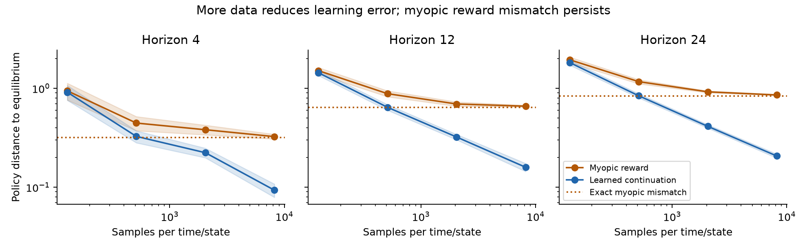
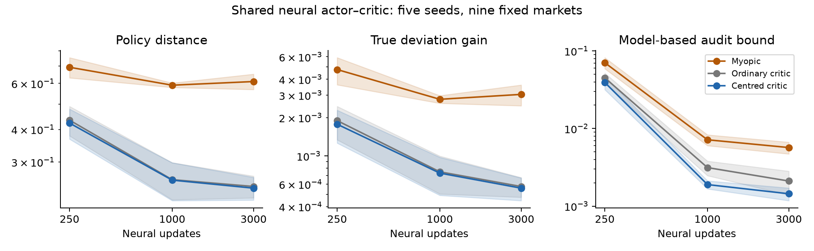

# RL pilot results — 9 October 2026

**Final results:** see `FINAL_RESEARCH_REPORT.md` and `results/rl-extension/final_summary.json`. This report records the five-seed pilot; the final paper uses the twenty-seed extension.

---

# Reinforcement-learning extension: results and research direction

This report records the first RL experiment, before the final twenty-seed extension and PPO comparison. The earlier finance experiments were held fixed.

## What changed in the research question

The existing project measures the difference between a reward-induced policy and a
known financial target. Its strongest evidence concerns exact reward mismatch,
calibration under constraints and costs, and the interaction with covariance
estimation. It does not yet establish a novel, broadly superior RL algorithm.
In particular, the earlier dependent-return correction required the equilibrium's
continuation value. The historical softmax experiment was a statewise optimisation
diagnostic, not a shared predictive RL policy.

The new question is: **after training an actor–critic agent, how can we tell whether
its decisions satisfy the intended terminal mean–variance equilibrium, without
having the correct equilibrium policy available?** A second question is how to tell
whether a failure comes from the reward, the critic, or an unfinished actor update.

This leads to a more concrete candidate contribution than adding PPO to an existing
calibration formula: a quantitative audit of the trained agent, together with a
continuation-aware learning implementation and experiments that can falsify the audit.

## What the recent literature rules out

The primary-paper search found important positive precedents. These narrow our
novelty claim; they should not be portrayed as papers that ignore their objectives.

| Primary work | What it already provides | How we use it / remaining distinction |
|---|---|---|
| Lesmana and Pun, SIAM Journal on Financial Mathematics, 2025; DOI 10.1137/23M1594510 | Equilibrium RL and extended backward policy iteration | We read algorithm and experiment sections of the 2021 arXiv version, plus verified final publication metadata. Our backward learner specialises those principles. It is not a full final-paper replication. |
| Guo, Huang and Yu, arXiv:2606.11798v1, June 2026 | Deterministic actor–critic equilibrium learning using auxiliary functions and modified rewards | Learning an equilibrium through an auxiliary reward is already prior art. Our candidate concerns finite-iterate discrete-time deviation certificates. |
| Sangadi, Prashanth L.A. and Jagannathan, arXiv:2406.07892v2, March 2025 | Finite-sample mean–variance actor–critic analysis for discounted return | We cannot claim the first finite-sample risk-sensitive actor–critic result. Its initial-state stationarity target differs from the per-state equilibrium deviation audited here. |
| Chen, Zhang, Zhang, Haque and Maguluri, arXiv:2502.14208v1, February 2025 | Seminorm fixed-point and learning theory | Removing irrelevant critic offsets and using seminorm geometry are established ideas. Our proposed financial certificate uses these ideas, rather than inventing them. |
| Maurer and Pontil, COLT 2009 | Empirical Bernstein confidence bounds | Their Theorem 4 supplies the variance-sensitive sampling allowance; that concentration inequality is not our contribution. |

Exact versions, reading coverage, equations/sections, objectives, algorithms, data
and comparison roles are in `literature/rl-extension-2026/records.json` and the
updated 38-paper `literature/LITERATURE_LEDGER.md`. These were targeted full-text
readings, not claims to have checked every appendix of every new paper. The final
2025 SPERL full text remains an access/concordance gap. Absence of a match in this
search does not prove novelty.

## The candidate theoretical result

For a learned policy, consider changing the action at one time and state while
keeping all future actions unchanged. The largest possible increase in the
conditional terminal mean–variance objective is its **one-step deviation gain**.
If that gain is at most epsilon at every state, the policy is an epsilon equilibrium.
This is different from globally maximising the initial investor's precommitment value.

Under an exogenous finite-state return process, linear wealth dynamics, a deterministic
riskless rate, and wealth-independent deterministic actions, we derive a bound of
the form

    square root of deviation gain
       <= actor contribution + reward contribution + critic contribution.

The actor and reward contributions use conditional covariance-scaled action
gradients. The critic contribution uses the range across states of its Bellman
residuals, propagated backwards with a mixing coefficient. Crucially, it does not
require the solved equilibrium policy. The exact-model version still requires
conditional market moments; a separate held-out-sample version replaces these
unknown quantities by confidence bounds.

The mathematical derivation extends to vector returns with a positive definite
covariance matrix. Its critic term has no explicit asset-count factor. **That does
not make covariance estimation dimension-free**: the practical statistical problem
can still deteriorate with portfolio dimension. The numerical learner/auditor in
this extension currently uses one risky asset and observed regimes.

We also proved a constrained-action corollary. For a fixed convex action set, replace
the ordinary gradient term by the improvement attainable within that set under the
critic-based quadratic objective. This certifies exact boundary optima correctly.
The scalar box implementation is tested; a general constrained vector experiment
and transaction-cost state extension have not been completed.

**Status:** the algebraic statements are proved under the listed assumptions and
checked numerically. Their publication priority is **open**. They are not a general
deep-RL convergence theorem. Full assumptions and proofs are in
`notes/rl-extension/RESIDUAL_CERTIFICATE.md`.

## Why ordinary learning diagnostics can be misleading

Two distinct failure modes are now explicit.

First, a time-dependent constant added to the critic can make its numerical value
error very large while leaving the policy-relevant covariance unchanged. Our bound
is invariant to this offset. Across the 20 saved audit cases, adding large offsets
changed the bound by at most 1.7e-15, within floating-point noise.

Second, actor convergence alone does not verify the financial objective. A saved
four-period counterexample has exactly zero critic-based action gradient, yet its
true maximum one-step deviation gain is 0.10263. The residual certificate detects
the problem; its bound is 0.89674. This intentionally constructed stress test is
not a claim about the typical behaviour of any published algorithm.

The practical motivation for state-centred critic learning is therefore precise:
learn the differences across regimes that influence decisions. This is a specialised
application of existing seminorm ideas, with a financial interpretation and an audit.

## Learning without the earlier oracle

New training functions receive sampled excess returns and successor regimes. They
do not receive true transition probabilities, conditional means/variances, the
equilibrium policy or its continuation value. The conditional simulator supplies
independent observations for each time and regime. This is **generative-model access**,
stronger than having one historical market trajectory.

The tabular learner works backwards. A mean critic learns expected remaining
terminal gains, and the actor uses pairs of independent conditional observations
to estimate both return variance and its covariance with the continuation critic.
The paired quadratic reward has the desired conditional action gradient. This is
a standard paired covariance construction within a structured equilibrium learner,
not a new general replacement for SPERL.

The neural pilot has shared actor and critic networks, each with two 32-unit tanh
layers, taking time and regime as inputs. It uses sampled TD targets, target-critic
averaging and gradient actor updates. No equilibrium supervision or oracle
initialisation is used. All compared methods use the same data, network initialisation,
learning rates and update budgets. Because returns and regime transitions are
exogenous and fully observed, action exploration is unnecessary for this particular
conditional-data experiment. We do not generalise that property to arbitrary RL.

## Controlled numerical evidence

The tabular protocol was fixed before observing results: persistence 0.5/0.8/0.95,
horizon 4/12/24, four sample budgets, twenty seeds and three methods. The 2,160 saved
records include a myopic comparator, continuation-aware actor updates, and exact
optimisation of the same sampled actor objective as an optimisation control.

| Samples per time/state | Myopic policy distance | Continuation-aware policy distance | Myopic maximum deviation gain | Continuation-aware maximum deviation gain |
|---:|---:|---:|---:|---:|
| 128 | 1.49745 | 1.43622 | 0.029357 | 0.024452 |
| 512 | 0.87197 | 0.66048 | 0.008086 | 0.004176 |
| 2,048 | 0.65725 | 0.33050 | 0.004280 | 0.001004 |
| 8,192 | 0.58709 | 0.16494 | 0.003319 | 0.000273 |

Entries average equally over the nine fixed markets and twenty seeds. More data
reduces the continuation-aware learner's error, while myopic calibration retains
reward mismatch. This is **numerically verified** in this grid. The maximum
distance difference between forty actor steps and the sampled exact-optimisation
control is 5.24e-5; thus actor optimisation is not the dominant error here.

The neural pilot contains 135 training runs and 405 checkpoints: nine markets,
five seeds, three critic/reward variants and update counts 250/1,000/3,000. Results
at the fixed final budget are:

| Method | Policy distance | Maximum deviation gain | Exact-model audit bound |
|---|---:|---:|---:|
| Myopic reward, ordinary critic | 0.610208 | 0.003042 | 0.005686 |
| Continuation-aware reward, ordinary critic | 0.241841 | 0.000576 | 0.002105 |
| Continuation-aware reward, centred critic | 0.238264 | 0.000559 | 0.001442 |

The centred continuation-aware variant improves average distance by 61.0% and
deviation gain by 81.6% relative to the myopic network. Against the ordinary
continuation-aware critic, the additional changes are only 1.48% and 2.91%; the
audit bound improves by 31.5%. **Most of the benefit comes from including the
continuation term, not from a dramatically better neural architecture.** Centring
does not win every individual market/metric combination.

Paired bootstrap intervals are saved for seed-level averages over all nine markets.
For centred minus ordinary critic, distance difference is -0.00358, interval
[-0.00471,-0.00244]. There are only five seeds, and these are related synthetic
markets; these intervals are preliminary and do not establish broad superiority.
Figure bands are descriptive mean ±1.96 standard errors across seeds, not
simultaneous confidence bands. No seed or checkpoint was selected by oracle quality.

## Can the audit work without exact model moments?

For twenty independently trained, fixed policies in the 12-period, persistence0.8
market, we used a separate audit set with 32,768 observations per time/state:
786,432 audit observations per policy. Known bounded return support is assumed.

| Audit construction | Mean bound on maximum deviation gain |
|---|---:|
| Original Hoeffding, no mixing estimate | 0.036141 |
| Hoeffding with confidence-bounded mixing | 0.015913 |
| Empirical Bernstein, no mixing estimate | 0.013033 |
| Empirical Bernstein with confidence-bounded mixing | 0.004911 |
| Exact-model residual bound, diagnostic only | 0.001257 |
| Actual maximum deviation gain, diagnostic only | 0.000902 |

All twenty policies were covered by each construction. The stated 95% guarantee
comes from the proof and assumptions, **not** from seeing 20/20 empirical coverage.
Each construction has its own simultaneous-over-states guarantee; no joint guarantee
over all alternative constructions or training policies is claimed. The Bernstein
and mixing refinements were added after seeing that the primary Hoeffding bounds
were loose, and are labelled a sequential exploratory refinement.

This establishes feasibility in a simulator, but it is expensive and still
conservative. It does not establish a useful certificate from sparse historical
data. Nonpositive estimated variance lower bounds correctly yield an infinite,
uninformative bound rather than an artificial positive variance floor.

## Verification and code changes

New research modules:

- `mvrl/equilibrium_audit.py`: exact deviations, residual bounds, independent-data
  confidence bounds and scalar constrained audit.
- `mvrl/equilibrium_learning.py`: sample collection and backward actor/critic learner.
- `mvrl/neural_equilibrium.py`: shared neural actor/critic pilot.

The new tests check independent terminal-moment deviations, random critics,
constant-shift invariance, terminal errors, vector covariance projection, boundary
optima, data support, reproducibility and sampled optimisation controls. The final suite contains 50 existing tests and 24 new extension tests, including
constrained boundaries and false actor convergence. **All 74 tests pass**; execution status is
saved in the worklog and `results/rl-extension/test_status.json`.

All 2,160 tabular records and 405 neural checkpoints were reconstructed from saved
policies. Largest discrepancy was 4.45e-16; no tested policy violated its exact-model
bound. These reconstructions verify saved output consistency; independent formula
checks reside in the tests. Existing paper and pre-extension code/test hashes match
the preserved manifest. No historical result was silently replaced.

Reproduce from the project root with the environment in
`results/rl-extension/environment.txt` and `PYTHONPATH=.`:

1. `python -m pytest -q`
2. `python scripts/run_equilibrium_audit.py`
3. `python scripts/run_neural_equilibrium.py`
4. `python scripts/run_certificate_refinement.py`
5. `python scripts/summarise_rl_extension.py`

The neural runner reuses its saved per-run caches; remove/move those caches before
an intentional fresh training rerun. The fixed Stage-A protocol is preserved with
its matching original hash in `PROTOCOL_STAGE_A.md`; the combined protocol records
the subsequently fixed neural pilot. Reproduction does not require the downloaded
external papers. No previous manuscript generator should be run to incorporate
this extension automatically.

## What we can defensibly say now

**Candidate punchline:** We turn reward alignment into a check on a learned agent:
under a controlled dependent-return model, actor and critic residuals bound the gain
from deviating from the intended financial equilibrium. The audit distinguishes
irrelevant critic offsets from errors that distort decisions and supports a
continuation-aware learner that does not need a supplied target policy.

This is stronger than an oracle-only reward comparison. It is not yet evidence that
we outperform recent portfolio-RL methods on historical investment returns, nor is
the underlying backward learner itself a new general RL algorithm.

## Remaining research, in priority order

1. Check the final SPERL text and nearby approximate-equilibrium certification work
   before promoting the residual theorem to a novelty claim. Current evidence
   supports a narrow candidate, not a “first” statement.
2. Reproduce an identifiable published equilibrium actor–critic baseline at matched
   data/compute budgets. The ordinary-critic control here is an implementation
   ablation, not a relabelled replication of Guo2026 or the final SPERL algorithm.
3. Add a genuine sequential PPO comparator under its defined objective, separating
   its optimisation error from the different target of its reward. Do not call an
   intentional log-growth or reward-volatility objective financially incorrect.
4. Test larger state spaces, multiple assets, constrained neural actions and
   sensitivity to architecture, learning rates and seeds. The vector proof is not
   a completed high-dimensional deep-RL experiment.
5. Develop a chronological real-data RL protocol with held-out regimes and explicit
   data-coverage assumptions. Existing French-industry experiments are intact, but
   **no new historical RL performance result was obtained in this extension**.
6. Tighten sample requirements or explicitly allow the audit to abstain when data
   cannot support certification. Address dependence and policy selection before
   applying confidence claims to historical trajectories.
